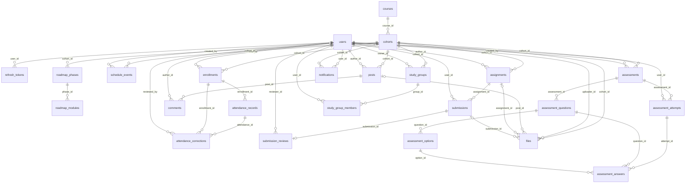

# MariaDB 데이터베이스와 ERD

구현 기준은 `src/main/resources/db/migration/V1__lms_schema.sql`입니다. 24개 테이블과 42개 외래 키가 있으며 실제 마이그레이션 SQL과 ERD Cloud 스냅샷 JSON을 함께 제공합니다.

## 제공 파일

| 파일 | 용도 |
|---|---|
| [erd/lms.erdcloud.json](erd/lms.erdcloud.json) | **ERD Cloud Upload Snapshot용**. 24개 엔티티·42개 관계·화면 배치 포함 |
| [erd/lms-mariadb.sql](erd/lms-mariadb.sql) | 실제 V1 스키마. MariaDB 생성·ERD Cloud SQL Import 입력 자료 |
| [erd/lms-schema.json](erd/lms-schema.json) | 컬럼·타입·널 허용·PK·FK·유니크·CHECK·인덱스를 담은 자체 JSON |
| [erd/erdcloud-format-source.json](erd/erdcloud-format-source.json) | 공식 형식의 출처·검증 범위 |

## ERD Cloud JSON 가져오기

1. ERD Cloud에서 새 빈 다이어그램을 엽니다.
2. 하단 **Import → Upload Snapshot**을 누릅니다.
3. `lms.erdcloud.json` 파일을 선택합니다.
4. 가져온 엔티티와 연결선을 확인하고 **Zoom fit** 또는 **Auto Layout**으로 배치를 조정합니다.

기존 다이어그램에 가져오면 ERD Cloud는 물리 이름이 같은 테이블을 건너뛰고 관계의 ID를 기존 테이블에 연결합니다. 새 빈 다이어그램으로 가져오면 전체 구조를 확인하기 쉽습니다. 이 작업에서는 사용자의 기존 다이어그램을 변경하거나 파일을 업로드하지 않았습니다.

JSON은 [ERD Cloud 공식 공개 프런트엔드 코드](https://www.erdcloud.com/5047fbca2ec9ce8539d8b7739ab250f2f1850d14.js?meteor_js_resource=true)의 실제 스냅샷 내보내기·가져오기 데이터 구조를 확인해 생성했습니다. `entityData`, `memoData`, `domainData`, 엔티티·컬럼·관계 ID와 허용된 관계 타입을 사용하며 공식 가져오기 정규화 로직과 참조 무결성을 로컬에서 검증했습니다. 실제 서비스 업로드·렌더링 검증은 수행하지 않았습니다. ERD 그림은 타입·NULL·PK·FK·기본값을 표현하고, 유니크·CHECK·인덱스·AUTO_INCREMENT의 실행 기준은 SQL 및 `lms-schema.json`입니다.

## SQL로 가져오기

하단 **Import**의 SQL 창에 `lms-mariadb.sql` 전체 내용을 붙여 넣고 **Import**를 누르는 방법도 사용할 수 있습니다. SQL Import에서 CHECK·인덱스 등 일부 세부 제약의 그림 표현은 도구의 파서 지원 범위에 따릅니다.

## 테이블

| 테이블 | 역할 |
|---|---|
| `users` | 회원·전역 역할·계정 상태 |
| `refresh_tokens` | 해시된 갱신 토큰·회전 이력 |
| `courses` | 교육 과정 |
| `cohorts` | 과정별 기수·교육 기간·교육 링크 |
| `enrollments` | 사용자별 기수 역할·수강 상태 |
| `schedule_events` | 강의·프로젝트·특강·휴일 일정 |
| `roadmap_phases` | 로드맵 단계 |
| `roadmap_modules` | 단계 내 교육 모듈 |
| `attendance_records` | 수강 등록별 일자 출결 |
| `attendance_corrections` | 출결 정정 요청·검토 |
| `posts` | 기수 게시글·공지 |
| `comments` | 게시글 댓글 |
| `assignments` | 과제·기한·배점 |
| `submissions` | 회원별 과제 제출 |
| `submission_reviews` | 제출물 점수·피드백 |
| `assessments` | 객관식 평가·응시 기간 |
| `assessment_questions` | 평가 문항·순서·배점 |
| `assessment_options` | 문항 선택지·정답 |
| `assessment_attempts` | 평가 응시·점수 |
| `assessment_answers` | 응시별 선택 답안·채점 결과 |
| `study_groups` | 기수 내 스터디 |
| `study_group_members` | 스터디 참여 회원 |
| `notifications` | 개인 알림·읽음 상태 |
| `files` | 첨부파일 메타데이터·소속 리소스 |

## 관계



## 주요 제약과 저장 규칙

- 사용자와 기수는 `enrollments`로 연결합니다. 전역 `users.role`과 기수별 `enrollments.role`을 구분합니다.
- 회원·기수, 수강 등록·출결 날짜, 과제·회원, 평가·회원, 응시·문항, 스터디·회원은 각각 유니크입니다.
- 제출물당 피드백은 하나이며 수정 시 같은 행을 갱신합니다. 평가 답안의 선택지는 문항에 속해야 하고 이는 서비스에서 검증합니다.
- 파일은 게시글·과제·제출물 중 정확히 하나에 속하도록 CHECK로 제한합니다. 디스크 파일과 `files` 메타데이터를 함께 사용합니다.
- 게시글·댓글·파일은 `deleted_at`으로 논리 삭제합니다. 그 외 FK는 기본 RESTRICT이며 일괄 연쇄 삭제를 하지 않습니다.
- 비밀번호는 BCrypt, 갱신 토큰은 SHA-256 해시로 저장합니다. 토큰 원문은 JSON 스키마/ERD/문서에 포함하지 않습니다.
- `DATETIME(6)`은 UTC 기준으로 저장하고 API는 오프셋이 포함된 ISO 8601 문자열을 반환합니다. 교육 날짜와 월별 필터는 한국 시간 기준입니다.
- 평가 점수는 0~100으로 정규화하며, 과제 점수는 과제의 `max_score` 범위 안에서 검증합니다.

## 재생성

```powershell
python scripts/generate-docs.py
```

테이블 구조는 V1 SQL을 읽어 재생성하고, API 계약은 컨트롤러 경로와 대조합니다. 마이그레이션을 추가할 때 생성기도 함께 갱신하세요.
