# MariaDB 데이터베이스와 ERD

실행 기준은 `src/main/resources/db/migration`의 V1 + V2 + V3 + V4입니다. `docs/erd/lms-mariadb.sql`는 네 마이그레이션 적용 후의 전체 스키마입니다. 35개 테이블과 61개 외래 키를 ERD Cloud 스냅샷 JSON으로 제공합니다.

V2는 추가 기능의 DB 기반이고, V3는 관리자 계정 발급 이력입니다. V4는 현재 과제 화면의 과목 표시명과 제출 배포 URL을 저장하며 기존 행은 NULL을 유지합니다. 관리자 계정 발급·출결 소명·과제 제출/첨부/평가 API를 구현했습니다. AI·영상·Discord의 신규 Java 모델·저장소 인터페이스는 기반이며 서비스·컨트롤러·외부 호출 구현은 각 담당자 작업 범위입니다. [설계 범위](foundation/DOMAIN_PLAN.md)와 [팀 인수인계](foundation/TEAM_HANDOFF.md)를 먼저 확인하세요.

## 제공 파일

| 파일 | 용도 |
|---|---|
| [erd/lms.erdcloud.json](erd/lms.erdcloud.json) | **ERD Cloud Upload Snapshot용**. 35개 엔티티·61개 관계·화면 배치 포함 |
| [erd/lms-mariadb.sql](erd/lms-mariadb.sql) | V1+V2+V3+V4 통합 스키마. 새 DB 생성·ERD Cloud SQL Import용. 기존 DB에는 Flyway 후속 마이그레이션 적용 |
| [erd/lms-schema.json](erd/lms-schema.json) | 컬럼·타입·널 허용·PK·FK·유니크·CHECK·인덱스를 담은 자체 JSON |
| [erd/erdcloud-format-source.json](erd/erdcloud-format-source.json) | 공식 형식의 출처·검증 범위 |

## ERD Cloud JSON 가져오기

1. ERD Cloud에서 새 빈 다이어그램을 엽니다.
2. 하단 **Import → Upload Snapshot**을 누릅니다.
3. `lms.erdcloud.json` 파일을 선택합니다.
4. 가져온 엔티티와 연결선을 확인하고 **Zoom fit** 또는 **Auto Layout**으로 배치를 조정합니다.

**이전 24개 테이블 다이어그램에 재업로드하지 말고 반드시 새 빈 다이어그램에서 가져오세요.** ERD Cloud는 물리 이름이 같은 기존 테이블을 건너뛰므로 변경된 컬럼·색상·제약이 갱신되지 않습니다. 잘못된 색상으로 가져오기에 실패했어도 테이블이 이미 저장될 수 있습니다. 이번 35개 테이블 기반 파일은 사이트에 직접 업로드하지 않았습니다.

JSON은 [ERD Cloud 공식 공개 프런트엔드 코드](https://www.erdcloud.com/362fd7b87ef4582c2b50d92b6825046e74d62296.js?meteor_js_resource=true)의 실제 스냅샷 내보내기·가져오기 데이터 구조를 확인해 생성했습니다. `entityData`, `memoData`, `domainData`, 엔티티·컬럼·관계 ID와 허용된 관계 타입을 사용하며 공식 가져오기 처리·색상 팔레트·참조 무결성을 로컬에서 검증했습니다. 실제 서비스 업로드·렌더링 검증은 수행하지 않았습니다. ERD 그림은 타입·NULL·PK·FK·기본값을 표현하고, 유니크·CHECK·인덱스·AUTO_INCREMENT의 실행 기준은 SQL 및 `lms-schema.json`입니다.

## SQL로 가져오기

하단 **Import**의 SQL 창에 `lms-mariadb.sql` 전체 내용을 붙여 넣고 **Import**를 누르는 방법도 사용할 수 있습니다. SQL Import에서 CHECK·인덱스 등 일부 세부 제약의 그림 표현은 도구의 파서 지원 범위에 따릅니다.

## 테이블

| 테이블 | 역할 |
|---|---|
| `users` | 회원·전역 역할·계정 상태 |
| `refresh_tokens` | 해시된 갱신 토큰·회전 이력 |
| `courses` | 교육 과정 |
| `cohorts` | 과정별 기수·교육 기간·교육 링크 |
| `enrollments` | 사용자별 기수 역할·수강 상태 |
| `schedule_events` | 강의·프로젝트·특강·휴일 일정 |
| `roadmap_phases` | 로드맵 단계 |
| `roadmap_modules` | 단계 내 교육 모듈 |
| `attendance_records` | 수강 등록별 일자 출결 |
| `attendance_corrections` | 출결 정정 요청·검토 |
| `posts` | 기수 게시글·공지 |
| `comments` | 게시글 댓글 |
| `assignments` | 과제·기한·배점 |
| `submissions` | 회원별 과제 제출 |
| `submission_reviews` | 제출물 점수·피드백 |
| `learning_subjects` | 기수별 과목 |
| `learning_units` | 과목별 단원 |
| `learning_topics` | 단원별 핵심 개념·복습 주제 |
| `assessments` | 객관식 평가·응시 기간 |
| `assessment_questions` | 평가 문항·순서·배점 |
| `assessment_options` | 문항 선택지·정답 |
| `assessment_attempts` | 평가 응시·점수 |
| `assessment_answers` | 응시별 선택 답안·채점 결과 |
| `study_groups` | 기수 내 스터디 |
| `study_group_members` | 스터디 참여 회원 |
| `notifications` | 개인 알림·읽음 상태 |
| `files` | 첨부파일 메타데이터·소속 리소스 |
| `lecture_videos` | 날짜·교시별 YouTube 강의 |
| `lecture_chapters` | 강의 소단원·시작 시각 |
| `assessment_question_review_links` | 평가 문항과 복습 구간 연결 |
| `review_sessions` | 개인 AI 복습의 공통 부모 |
| `blank_reviews` | 백지 복습 내용·세 부분 피드백 |
| `review_quizzes` | 객관식 복습 세션·순차 문제 번호 |
| `review_quiz_questions` | 4개 보기·단일 선택·채점 결과 |
| `notice_deliveries` | Discord 공지 전송 스냅샷·처리 이력 |

## 관계

```mermaid
erDiagram
    users |o--o{ users : "provisioned_by"
    users ||--o{ refresh_tokens : "user_id"
    courses ||--o{ cohorts : "course_id"
    cohorts ||--o{ enrollments : "cohort_id"
    users ||--o{ enrollments : "user_id"
    cohorts ||--o{ schedule_events : "cohort_id"
    users ||--o{ schedule_events : "created_by"
    cohorts ||--o{ roadmap_phases : "cohort_id"
    roadmap_phases ||--o{ roadmap_modules : "phase_id"
    enrollments ||--o{ attendance_records : "enrollment_id"
    attendance_records ||--o{ attendance_corrections : "attendance_id"
    enrollments ||--o{ attendance_corrections : "enrollment_id"
    users |o--o{ attendance_corrections : "reviewed_by"
    cohorts ||--o{ posts : "cohort_id"
    users ||--o{ posts : "author_id"
    posts ||--o{ comments : "post_id"
    users ||--o{ comments : "author_id"
    cohorts ||--o{ assignments : "cohort_id"
    users ||--o{ assignments : "author_id"
    users |o--o{ assignments : "instructor_id"
    assignments ||--o{ submissions : "assignment_id"
    users ||--o{ submissions : "user_id"
    submissions ||--o| submission_reviews : "submission_id"
    users ||--o{ submission_reviews : "reviewer_id"
    cohorts ||--o{ learning_subjects : "cohort_id"
    learning_subjects ||--o{ learning_units : "subject_id"
    learning_units ||--o{ learning_topics : "unit_id"
    cohorts ||--o{ assessments : "cohort_id"
    users ||--o{ assessments : "created_by"
    assessments ||--o{ assessment_questions : "assessment_id"
    learning_topics |o--o{ assessment_questions : "topic_id"
    assessment_questions ||--o{ assessment_options : "question_id"
    assessments ||--o{ assessment_attempts : "assessment_id"
    users ||--o{ assessment_attempts : "user_id"
    assessment_attempts ||--o{ assessment_answers : "attempt_id"
    assessment_questions ||--o{ assessment_answers : "question_id"
    assessment_options ||--o{ assessment_answers : "option_id"
    cohorts ||--o{ study_groups : "cohort_id"
    users ||--o{ study_groups : "owner_id"
    study_groups ||--o{ study_group_members : "group_id"
    users ||--o{ study_group_members : "user_id"
    users ||--o{ notifications : "user_id"
    cohorts |o--o{ notifications : "cohort_id"
    cohorts ||--o{ files : "cohort_id"
    users ||--o{ files : "uploader_id"
    posts |o--o{ files : "post_id"
    assignments |o--o{ files : "assignment_id"
    submissions |o--o{ files : "submission_id"
    cohorts ||--o{ lecture_videos : "cohort_id"
    users ||--o{ lecture_videos : "created_by"
    lecture_videos ||--o{ lecture_chapters : "video_id"
    learning_topics |o--o{ lecture_chapters : "topic_id"
    assessment_questions ||--o{ assessment_question_review_links : "question_id"
    lecture_chapters ||--o{ assessment_question_review_links : "chapter_id"
    users ||--o{ review_sessions : "user_id"
    learning_topics ||--o{ review_sessions : "topic_id"
    review_sessions ||--o| blank_reviews : "session_id"
    review_sessions ||--o| review_quizzes : "session_id"
    review_quizzes ||--o{ review_quiz_questions : "quiz_session_id"
    posts ||--o{ notice_deliveries : "post_id"
    users ||--o{ notice_deliveries : "requested_by"
```



## 주요 제약과 저장 규칙

- 사용자와 기수는 `enrollments`로 연결합니다. 전역 `users.role`과 기수별 `enrollments.role`을 구분합니다.
- 회원·기수, 수강 등록·출결 날짜·회차 번호, 과제·회원, 평가·회원, 응시·문항, 스터디·회원은 각각 유니크입니다.
- DATE 출결은 session_no=0, SESSION 출결은 양수입니다. 기존 출결 API도 일자·회차를 구분하고 삭제 기록은 조회·대시보드에서 제외합니다.
- 출결 정정은 요청 당시 상태·version 스냅샷과 INVALIDATED 상태를 담습니다. 승인 시 원본 상태·version을 검사하고 변경·삭제된 요청은 INVALIDATED로 무효화합니다. ABSENT→LATE/PRESENT, LATE/EXCUSED/LEAVE/EARLY→PRESENT를 허용합니다. 소명자료 파일 저장용 테이블은 추가하지 않습니다.
- 제출물당 피드백은 하나입니다. 제출물 파일 업로드 성공 시 submitted_at을 갱신합니다. 학생은 본인 제출·평가·첨부에만 접근합니다.
- AI 복습은 review_sessions와 blank_reviews/review_quizzes의 공유 PK·FK로 IS-A를 표현합니다. 부모 mode와 자식 종류 일치·배타성은 서비스 트랜잭션에서 보장해야 합니다.
- AI 퀴즈 한 문제는 필수 보기4개와 단일 선택 번호(1~4)를 가집니다. 동일 세션·문제 순번은 유니크입니다. 정답 공개 시점·다음 문제 동의·본인 접근은 담당자 구현 범위입니다.
- 과목→단원→핵심 개념이 복습 주제입니다. 영상은 날짜·교시, 소단원은 시작 초를 저장하며 평가 문항에서 연결합니다. 같은 기수인지와 해설 공개 여부는 서비스에서 확인해야 합니다.
- 파일은 게시글·과제·제출물 중 정확히 하나에 속하도록 CHECK로 제한합니다. 디스크 파일과 files 메타데이터를 함께 사용합니다.
- 출결·과제의 deleted_at을 기존 API에 연결했으며 원본·제출물·첨부 이력은 보존합니다. FK는 기본 RESTRICT이며 일괄 연쇄 삭제를 하지 않습니다.
- Discord 전송 이력은 notice_deliveries에 저장하며 Webhook URL과 AI 키는 서버 비밀 설정에서만 관리합니다.
- 비밀번호는 BCrypt, 갱신 토큰은 SHA-256 해시로 저장합니다. 토큰 원문은 JSON 스키마/ERD/문서에 포함하지 않습니다.
- DATETIME(6)은 UTC 기준으로 저장하고 API는 오프셋이 포함된 ISO 8601 문자열을 반환합니다. 교육 날짜와 월별 필터는 한국 시간 기준입니다.

## 재생성

```powershell
python scripts/generate-docs.py
```

테이블 구조는 V1+V2+V3+V4 통합 SQL을 읽어 재생성하고, API 계약은 실제 컨트롤러 경로와 대조합니다. 스키마 변경 시 마이그레이션·통합 SQL·도메인 모델을 함께 맞추고 마이그레이션 테스트로 일치 여부를 확인하세요.
